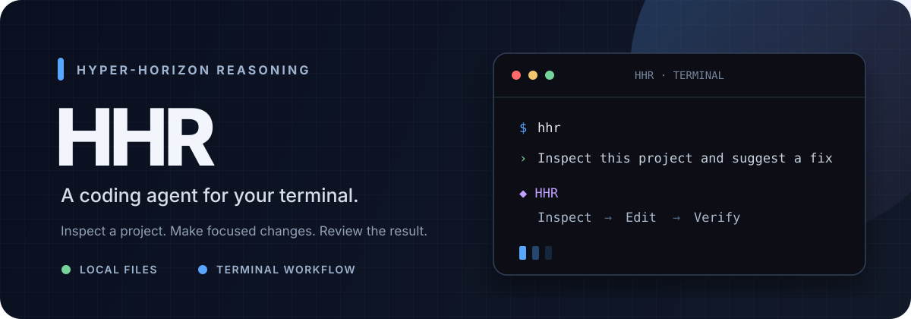
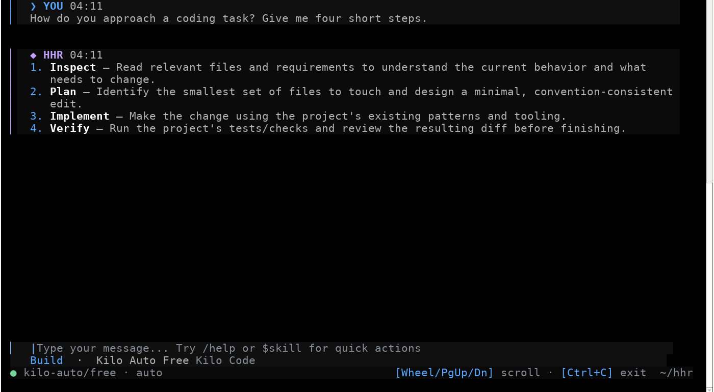

<div align="center">
  
  <p><strong>Inspect a project. Make focused changes. Review the result.</strong></p>
  <p>
    <a href="#quick-start">Quick start</a> ·
    <a href="#features">Features</a> ·
    <a href="#install-options">Install options</a> ·
    <a href="https://hhr-ai.vercel.app">Website</a>
  </p>
  <p>
    <a href="https://www.npmjs.com/package/hhr-ai"></a>
    
    
  </p>
</div>

**HHR (Hyper-Horizon Reasoning)** is a coding assistant that runs in your terminal. Start it in a project directory to ask questions about the code, inspect files, and work through coding tasks.

This is the documentation and installation repository. The HHR application is distributed separately through the npm package and the official installer.

## See HHR in action



<p align="center"><sub>Live HHR terminal capture · example prompts with no project files</sub></p>

## Features

- **Work in your terminal:** start HHR from a project and work in a persistent coding session.
- **Use local project tools:** inspect and search files, make edits, and run shell commands.
- **Review the workflow:** choose how prompts, file changes, and commands are handled; full access is available for the current run when you choose it.
- **Keep useful context:** reopen saved sessions, use skills, or request a findings-first review with `/review`.
- **Choose a model:** use Kilo Code's default free model or configure a model that requires an API key.

## Quick start

Requirements: Linux or macOS, Node.js 18 or newer with npm, and an interactive terminal.

```sh
npm install -g hhr-ai@latest
cd /path/to/your/project
hhr
```

HHR uses the Kilo Code gateway. The default model is `kilo-auto/free`; free models may be rate-limited. Models that require a key need a Kilo Code API key.

## Install options

### Install with npm

```sh
npm install -g hhr-ai@latest
```

The `hhr` command starts HHR. The launcher downloads the hosted terminal app the first time it runs and when an update is needed.

### Install with the standalone installer

To inspect the installer before running it, print it first:

```sh
curl -fsSL https://hhr-ai.vercel.app/install.sh
```

Then install:

```sh
curl -fsSL https://hhr-ai.vercel.app/install.sh | sh
```

The installer requires Node.js 18+, npm, and either `curl` or Node.js `fetch`. It installs the launcher in `~/.local/bin/hhr` and the app in `~/.local/lib/hhr-ai`. It may add `~/.local/bin` to your `.zshrc` and `.bashrc`; open a new terminal if `hhr` is not found.

Verify the install:

```sh
hhr --version
hhr --help
```

## Use HHR

Start HHR from the project you want to work in:

```sh
cd /path/to/your/project
hhr
```

HHR can inspect and search local files, use shell commands, and make code changes. Choose a permission mode that fits the task. **Full access** runs file edits and shell commands without approval until HHR exits. Review the selected mode before starting work.

Useful commands:

| Command | What it does |
| --- | --- |
| `hhr` | Start a session |
| `hhr install` | Install or update the hosted terminal app |
| `hhr version` | Show the launcher version |
| `hhr help` | Show command help |

HHR also supports `/review` for a findings-first code review and `/agents` to inspect or delegate read-only investigations.

## Local data and permissions

HHR stores settings and saved conversations locally under `~/.hhr` (`config.json` and `sessions.json`). Model requests are routed through Kilo Code. Avoid sending secrets or private code unless you are authorized to share them with the service.

HHR's permission screen includes a **Confirm before send** mode for reviewing prompts before they leave the terminal. Full access disables edit and command approvals for the current run; switch back to another mode when you want those approvals again.

## Model setup

The default `kilo-auto/free` model does not require a key, though availability and rate limits can vary. For a model that requires an API key, set one of these variables before starting HHR:

```sh
export KILOCODE_API_KEY="your-key"
hhr
```

`HHR_KILOCODE_API_KEY` and `KILO_API_KEY` are also recognized. To choose a model ID, set `HHR_MODEL`:

```sh
export HHR_MODEL="provider/model-id"
hhr
```

Keep API keys private. Do not commit them to a repository or include them in shared logs.

## Update

Use the hosted installer to install the latest app files:

```sh
hhr install
```

You can also rerun the standalone installer:

```sh
curl -fsSL https://hhr-ai.vercel.app/install.sh | sh
```

For the npm launcher, install the latest published npm version:

```sh
npm install -g hhr-ai@latest
```

## Troubleshooting

### `hhr: command not found`

For a standalone install, add `~/.local/bin` to your current shell's `PATH`:

```sh
export PATH="$HOME/.local/bin:$PATH"
```

Open a new terminal after installation. For an npm install, check that npm's global binary directory is on your `PATH`. Find npm's global prefix with `npm prefix -g`; the executable directory is normally `bin` under that prefix.

### Node.js or npm is missing

Check your versions:

```sh
node --version
npm --version
```

Install Node.js 18 or newer with npm, then retry.

### Model requests fail

Check your network connection and model selection. Free models may be rate-limited. A paid model requires a valid Kilo Code API key in one of the environment variables above.

### Terminal display looks broken

Use an interactive terminal. If the display is left in an unusual state after an interruption, run `reset`.

## Uninstall

If installed through npm, remove the global package:

```sh
npm uninstall -g hhr-ai
```

The standalone installer files live in these locations; remove them if you used that installer or want to clear the app downloaded by the npm launcher:

```sh
rm -f "$HOME/.local/bin/hhr"
rm -rf "$HOME/.local/lib/hhr-ai"
```

Settings and saved sessions are stored under `~/.hhr`. Remove that directory separately if you also want to delete your local HHR data.

## Links

- [HHR website](https://hhr-ai.vercel.app)
- [Standalone installer](https://hhr-ai.vercel.app/install.sh)
- [npm package](https://www.npmjs.com/package/hhr-ai)

## Contributing

Documentation fixes and clarifications are welcome. See [CONTRIBUTING.md](CONTRIBUTING.md) for the guide. This repository is intentionally documentation-only; keep application source changes in the HHR application project. Before changing an install instruction, check it against the current installer or npm package. Never include API keys, saved sessions, or private project files in an issue or pull request.
